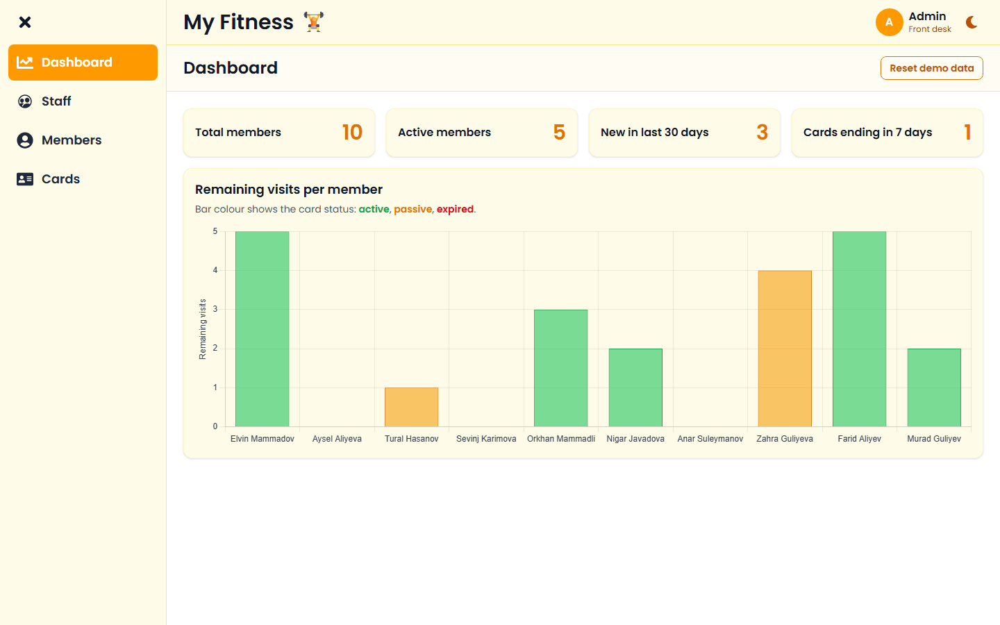

# My Fitness: gym admin dashboard

[](https://my-fitness-app-tau-drab.vercel.app/)

> AZ: İdman zalı üçün admin paneli (Next.js): üzvlər, kartlar, işçilər və statistika. Məlumatlar brauzerdə saxlanılır.

An admin dashboard for a small gym, built with Next.js. Front-desk staff can manage members, membership
cards and staff, and see a quick overview on the dashboard. All data is fictional demo data, and changes are
saved in your browser's localStorage (there is no backend).



## Features

- **Dashboard**: total and active members, new registrations in the last 30 days, cards ending within 7 days,
  and a bar chart of remaining visits coloured by card status. All dates are relative to today.
- **Members**: search, filter by status, add (with photo upload), view details, edit and delete.
- **Cards**: membership cards with status, end date and remaining visits; search by name or card ID.
- **Staff**: add, edit and delete staff members; each has a detail page at `/staff/[id]`.
- **Saved in the browser**: members, staff, theme and sidebar state persist in localStorage. "Reset demo data" restores the original list.
- **Responsive**: collapsible sidebar on desktop, slide-in drawer on phones; light and dark theme.
- **SEO**: page titles and descriptions, canonical URLs, Open Graph image, favicon, `robots.txt`, `sitemap.xml`.
  The old `/dashbroad` URL redirects to `/dashboard`.

## Tech stack

Next.js 15 (App Router) · React 19 · TypeScript · Tailwind CSS 4 · Zustand (with `persist`) · Chart.js / react-chartjs-2 · SweetAlert2 · react-icons

## Run locally

```bash
git clone https://github.com/codelady-ship/My-Fitness-App.git
cd My-Fitness-App
npm install
npm run dev                  # http://localhost:3000 (redirects to /dashboard)
npm run build && npm start   # production build
```

No environment variables are needed.

## Deployment

Deployed on Vercel from the `main` branch; every push to `main` runs `next build` and publishes the site.

## Project structure

```
Interface/      TypeScript types (member card, staff, sidebar link)
Mock/           demo members (dates relative to today), staff, sidebar links
Store/          Zustand stores: DataStore (members + staff, persisted), SidebarStore (UI, theme)
lib/utils.ts    date helpers, HTML escaping for popups, image resize for uploads
src/app/        pages: dashboard, users (members), cards, staff, staff/[id]
src/Components/ ClientShell (theme + layout), Navbar, Sidebar, PageHeader, Avatar
```

## What I learned

- A root `layout.tsx` with `"use client"` cannot export `metadata`, so the theme and stores live in a small client wrapper instead.
- Persisting Zustand state to localStorage without hydration errors (`skipHydration` and rehydrating after mount).
- Making demo data stay "current" by generating dates relative to today.
- Building a sidebar that is a collapsible rail on desktop and a drawer on phones.
- Giving charts fixed, meaningful colours instead of random ones.
- Escaping user input before putting it into HTML templates (SweetAlert2 popups).
