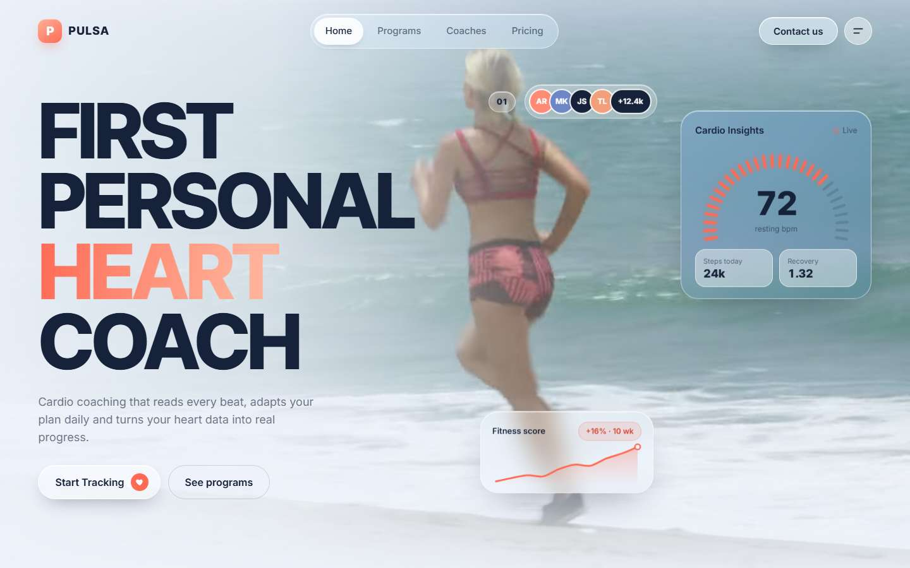
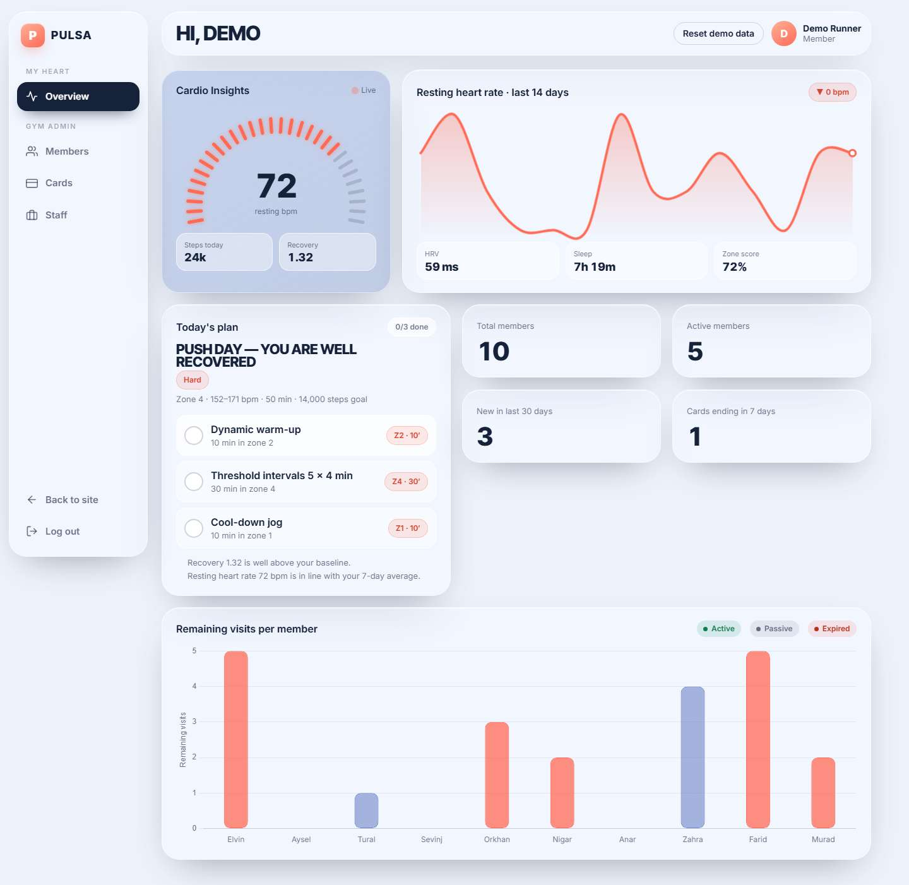

# Pulsa: your personal heart coach

[](https://my-fitness-app-tau-drab.vercel.app/)

> AZ: Pulsa ürək ritminə əsaslanan kardio-məşq tətbiqidir (Next.js). Landing, proqramlar, məşqçilər, qiymətlər, əlaqə forması, giriş/qeydiyyat və şüşə (glass) üslubunda idarə paneli: ürək göstəriciləri, gündəlik plan, üzvlər, kartlar, işçilər.

Pulsa is a full-stack cardio-coaching app. This repo started as **My Fitness**, a gym admin dashboard, and was
redesigned into a marketing site plus a user/admin dashboard in one "ink, coral and glass" design language.
The frontend talks to the Pulsa API (`backend/`, contract in `docs/API.md`) and falls back to bundled demo data
when the API is not configured, asleep or down, so the live site never breaks.





## Pages

| Route | What it is |
| --- | --- |
| `/` | Full-bleed fitness video hero: masked headline, glass "Cardio Insights" gauge (30 ticks on a 200° arc), self-drawing chart, pointer parallax |
| `/programs` | Heart-rate-zone programs from `GET /programs` |
| `/coaches` | Coaches from `GET /coaches` |
| `/pricing` | Plans from `GET /pricing-plans`, monthly/yearly toggle, FAQ |
| `/contact` | Validated form → `POST /contact` (saved in the browser if the API is down) |
| `/login`, `/register` | `POST /auth/login`, `/auth/register` (JWT + refresh token); demo session if the API is down |
| `/dashboard` | Resting-HR gauge and 14-day trend (`/metrics/summary`, `/metrics/days`), today's adaptive plan (`/plan/today`), gym stats, remaining-visits chart |
| `/users`, `/cards`, `/staff`, `/staff/[id]` | Gym admin: members, membership cards, staff (CRUD through `/members`, `/staff` for coach/admin accounts, otherwise localStorage) |

## Design

- Fonts: Inter Tight 800 (uppercase, −0.04em) for headlines, Inter for UI.
- Tokens in `src/styles/pulsa.css`: `--ink #16213a`, `--coral #ff6a55`, `--coral-2 #ffb199`, glass `rgba(255,255,255,.26)`, card gradient, padding `clamp(20px, 4.2vw, 64px)`.
- Motion: headline lines rise out of a mask 90 ms apart, cards pop in (scale .92 → 1), gauge ticks light one by one, numbers count up over 1.4 s (easeOutCubic), the chart line draws over 1.6 s, cards float ±6 px and drift with the pointer at different depths.
- `prefers-reduced-motion`: no animation, no parallax, video paused on its poster. Parallax is off on touch.
- If the browser pauses autoplay (low-power mode), `play()` is retried on the first interaction and on `visibilitychange`.
- Under 820 px: headline first, then the clip with only the gauge card; the CTA is full width.
- Videos: Pexels, re-encoded to 720p H.264 (≤ 1.4 MB) + WebM for the hero, hosted in `public/media`. See [docs/CREDITS.md](docs/CREDITS.md).

## Environment variables

| Variable | Example | Notes |
| --- | --- | --- |
| `NEXT_PUBLIC_API_URL` | `https://pulsa-api.example.com` | API origin; `/api/v1` is appended unless already present. Leave empty for demo mode. The API must allow the site origin in `CORS_ORIGINS`. |

Every request has an 8 s timeout. Network errors, timeouts and 5xx answers switch that view to demo data (and skip the API for 30 s); 4xx errors such as a wrong password are shown to the user.

Demo mode tip: with the API off, any email logs in; an email starting with `admin@` gets the admin role.

## Run locally

```bash
git clone https://github.com/codelady-ship/My-Fitness-App.git
cd My-Fitness-App
npm install
npm run dev                  # http://localhost:3000 (demo data)
# with the API (see backend/README.md):
NEXT_PUBLIC_API_URL=http://localhost:4000 npm run dev
npm run build && npm start   # production build
```

## Project structure

```
lib/api/        typed API client: fetch wrapper (timeout, refresh, fallback), mappers, demo seed data
lib/site.ts     site URL, nav links, media paths
src/app/(site)/ landing, programs, coaches, pricing, contact, login, register
src/app/(app)/  dashboard, users (members), cards, staff, staff/[id]
src/Components/pulsa/  Hero, Gauge, LineChart, BgVideo, SiteNav, PageHero, forms, hooks (count-up, parallax)
src/styles/pulsa.css   design tokens and components
Store/          Zustand: DataStore (members + staff, API or localStorage), SidebarStore (UI)
Interface/ Mock/       types and demo members/staff
```

## Tech stack

Next.js 15 (App Router) · React 19 · TypeScript · Tailwind CSS 4 + custom CSS · Zustand · Chart.js · SweetAlert2 · react-icons

## What I learned

- Splitting a site and an app into route groups so each gets its own layout without changing URLs.
- Writing one API layer with mappers so the UI never depends on raw server JSON, plus a timeout + fallback that keeps a static deploy working when the backend sleeps.
- Rotating short-lived JWTs with a refresh token transparently on a 401.
- Building a gauge and a self-drawing line chart in plain SVG (`pathLength` + `stroke-dashoffset`).
- Pointer parallax with eased CSS variables, and respecting reduced motion and touch.
- Earlier (My Fitness): hydration-safe Zustand persistence, demo dates relative to today, escaping user input in SweetAlert2 popups.
